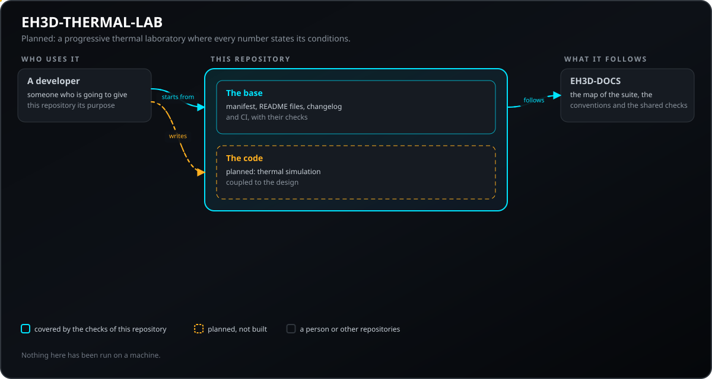
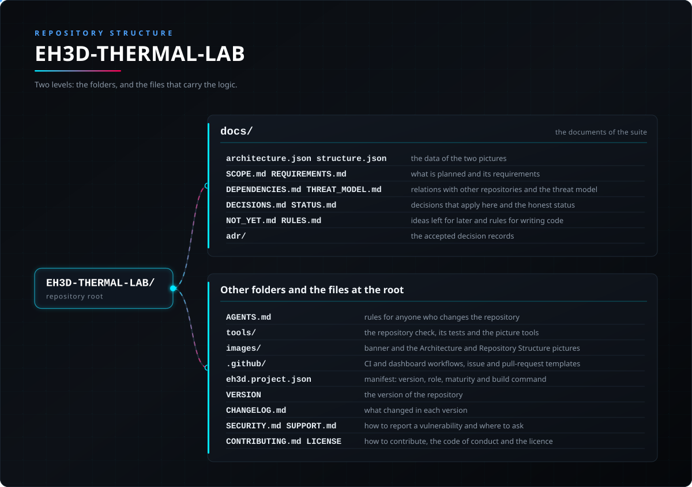

<p align="center">
  
</p>

# 🛠️ EH3D-THERMAL-LAB

<p align="center"><a href="README.md">🇺🇸 English</a> | 🇪🇸 <b>Español</b> | <a href="README_fra.md">🇫🇷 Français</a> | <a href="README_ita.md">🇮🇹 Italiano</a> | <a href="README_deu.md">🇩🇪 Deutsch</a> | <a href="README_zho.md">🇨🇳 中文</a> | <a href="README_jpn.md">🇯🇵 日本語</a> | <a href="README_por.md">🇵🇹 Português</a></p>

### EH3D-THERMAL-LAB: estimaciones térmicas de la etapa 1: el calentamiento de una pista de cobre y redes térmicas simplificadas, donde cada resultado dice sus hipótesis, condiciones y límites. Código inicial.

<p align="center">
  
  
  
  
  
  
</p>

---

**Comprobación de honestidad - lo que se ejecuta hoy:** una biblioteca de Rust y una línea de comandos que calculan el aumento de temperatura de una pista de cobre con corriente (efecto Joule, con la resistencia creciendo con la temperatura, enfriada por convección) y a través de una red de resistencias térmicas en serie y en paralelo. Un resultado solo se acepta con sus hipótesis, condiciones de contorno, materiales, incertidumbre, limitaciones y rango de validez; un caso que se calienta demasiado o no converge no da ningún número. Todo se ha ejecutado solo con casos hechos por sus propias pruebas y comparados con valores de fórmula cerrada; nada se comparó con un solucionador ni con una medida. Lo que no existe: el uso de pérdidas del dominio de simulación, el acoplamiento con la geometría mecánica y la comparación con medidas.

---

> **Estado de seguridad (safety) y de seguridad informática:** este repositorio está en sus primeros pasos y no es un sistema de seguridad (safety). Nada de lo escrito aquí sustituye los límites, los enclavamientos y la parada de emergencia de la máquina y de su controlador.

## 📋 De un vistazo

| | |
|---|---|
| Versión | `0.0.2` |
| Madurez | Andamiaje |
| Pruebas | 3 |
| Pila tecnológica | Markdown, Python 3.10+ |
| En hardware real | Aún no se ha ejecutado en hardware |

**Ir a:** [Resumen](#-resumen) · [Arquitectura](#-arquitectura) · [Inicio rápido](#-inicio-rápido) · [Pruebas](#-pruebas) · [Estructura del repositorio](#-estructura-del-repositorio) · [Proyectos relacionados](#-proyectos-relacionados)

## 🚦 Estado del proyecto

Cada línea es una parte de este repositorio y la luz dice hasta dónde llega hoy. Se escribe con lo que el repositorio puede demostrar (pruebas, compilaciones, ejecuciones), no con lo previsto.

🟢 Hecho y verificado · 🟡 Funciona, con límites conocidos · 🟠 Hecho a medias o sin verificar · 🔴 Sin hacer o sin funcionar

| Área | Estado | Qué significa aquí |
|---|---|---|
| Comprobaciones del repositorio | 🟡 | La comprobación del repositorio, la de las imágenes y las 3 pruebas de la base se ejecutan en el CI y pasan. |
| Pruebas | 🟡 | Las 21 pruebas del código Rust y las 3 de la base pasan en un ordenador. Usan solo casos hechos por las propias pruebas y valores de fórmula cerrada. |
| Hardware real | 🟠 | No se ha ejecutado en ninguna máquina ni placa: nada de aquí se ha probado en hardware. |
| Función planificada | 🟠 | Escrito: el calentamiento Joule de una pista, la red en serie y en paralelo, el resultado que se niega a existir sin sus condiciones y el rechazo de casos fuera de rango o sin convergencia. Sin escribir: fuentes de calor del dominio de simulación, la geometría de la herramienta mecánica y la comparación con medidas. |
| Requisitos | 🟠 | 4 de los 7 requisitos están en prototipo; las fuentes de calor, el acoplamiento con la geometría y la comparación con medidas solo están planificados. Ninguno está validado. |

## 🎯 Resumen

* **Lo que existe:** una biblioteca y una línea de comandos, sin ventana, que calculan el calentamiento de una pista (`trace`), el aumento a través de una red térmica (`network`) y comprueban que un resultado lleva todas sus condiciones (`check`). **Planificado:** fuentes de calor del dominio de simulación, el acoplamiento con la geometría y la comparación con medidas.

## 🧩 Papel en EH3D

EH3D-THERMAL-LAB forma parte de la familia PHOENIX de la EH3D Fabrication Suite. Lo que hará, lo que todavía no hará, sus requisitos y sus relaciones con otros repositorios están escritos en la carpeta `docs/`.

## 🏛️ Arquitectura

<p align="center">
  
</p>

Cómo encajan las partes de este repositorio: quién lo usa, qué contiene y de qué depende. La imagen se dibuja desde `docs/architecture.json` y se comprueba contra el código.

## 🚀 Inicio rápido

Necesitas Python 3.10 o posterior; no hay nada que instalar.

```bash
python -I tools/ci_validate.py
python -I tools/make_architecture.py --check
python -I tools/make_structure.py --check --readmes
python -I -m unittest discover -s tools -p "test_*.py"
```

## 🧪 Pruebas

La base tiene 3 pruebas (`python -I -m unittest discover -s tools -p "test_*.py"`), y pasan. El CI ejecuta la comprobación del repositorio, la de las imágenes y esas pruebas.

## 🏗️ Compilación y publicación

La versión vive en el fichero `VERSION` y en `eh3d.project.json`, y cada versión tiene su entrada en [CHANGELOG.md](CHANGELOG.md). No hay nada que compilar; las versiones se publican en GitHub.

## 📂 Estructura del repositorio

<p align="center">
  
</p>

<details>
<summary>Versión en texto del árbol</summary>

```text
EH3D-THERMAL-LAB/
├── docs/
│   ├── architecture.json structure.json         los datos de las dos imágenes
│   ├── SCOPE.md REQUIREMENTS.md                 lo planificado y sus requisitos
│   ├── DEPENDENCIES.md THREAT_MODEL.md          relaciones con otros repositorios y modelo de amenazas
│   ├── DECISIONS.md STATUS.md                   decisiones que se aplican aquí y estado honesto
│   ├── NOT_YET.md RULES.md                      ideas para más adelante y reglas para escribir código
│   └── adr/                                     los registros de decisiones aceptadas
├── AGENTS.md                                    reglas para quien cambia el repositorio
├── src/                                         la biblioteca y la línea de comandos
├── Cargo.toml Cargo.lock deny.toml              paquete de Rust y política de dependencias
├── tools/                                       la comprobación del repositorio, sus pruebas y las herramientas de las imágenes
├── images/                                      banner y las imágenes de Arquitectura y Estructura del repositorio
├── .github/                                     flujos de CI y del panel, plantillas de issues y pull requests
├── eh3d.project.json                            manifiesto: versión, rol, madurez y comando de compilación
├── VERSION                                      la versión del repositorio
├── CHANGELOG.md                                 qué cambió en cada versión
├── SECURITY.md SUPPORT.md                       cómo informar de una vulnerabilidad y dónde preguntar
└── CONTRIBUTING.md CODE_OF_CONDUCT.md LICENSE   cómo contribuir, el código de conducta y la licencia
```

</details>

## 🗺️ Hoja de ruta y límites conocidos

**Límites conocidos hoy**

* Código inicial: todo resultado es una estimación no comparada con un solucionador ni con una medida, y su incertidumbre es un valor provisional fijado en la configuración.

**Siguiente**

* Esperar a que se acepten los contratos de los que depende este proyecto (véase `docs/DEPENDENCIES.md`), escribir después la primera versión con pruebas y sustituir las filas de estado por resultados reales.

## 🌍 Idiomas

El README y los textos existen en inglés, español, francés, italiano, alemán, chino, japonés y portugués de Portugal.

## 🔗 Proyectos relacionados

* [EH3D-DOCS](https://github.com/JuanenRac/EH3D-DOCS): el mapa de la suite, su arquitectura, las convenciones y las comprobaciones compartidas
* Relaciones planificadas, aún sin construir (EH3D-PHOENIX-PCB, EH3D-PHOENIX-CAD, EH3D-COMMON, EH3D-LAB-BRIDGE, EH3D-COMPONENT-INTELLIGENCE): véase [docs/DEPENDENCIES.md](docs/DEPENDENCIES.md)

## 📚 Documentación

* [Las convenciones de la suite](https://github.com/JuanenRac/EH3D-DOCS/blob/main/docs/CONVENTIONS.md)
* [Registro de cambios](CHANGELOG.md)
* [Alcance, requisitos, dependencias, modelo de amenazas y decisiones](docs/SCOPE.md)

## 🤝 Contribuir y comunidad

* Antes de una pull request ejecuta `python -I tools/ci_validate.py` y las pruebas de la base: todo debe pasar. Consulta [CONTRIBUTING.md](CONTRIBUTING.md) y el [código de conducta](CODE_OF_CONDUCT.md).
* El README existe en ocho idiomas: un cambio en el texto se hace en los ocho archivos, y las dos imágenes se dibujan a partir de `docs/architecture.json` y `docs/structure.json` con `tools/make_architecture.py` y `tools/make_structure.py`.
* Informa de una vulnerabilidad en privado: [SECURITY.md](SECURITY.md). Preguntas, ideas e informes: electrohobby3d@gmail.com ([SUPPORT.md](SUPPORT.md)).

## 👤 AUTOR

**JuanenRac (Electro Hobby 3D)** · electrohobby3d@gmail.com

## 📜 LICENCIA

Software: GPL-3.0-or-later. Véase [LICENSE](LICENSE). Los diseños de hardware de la suite usan CERN OHL-S.
